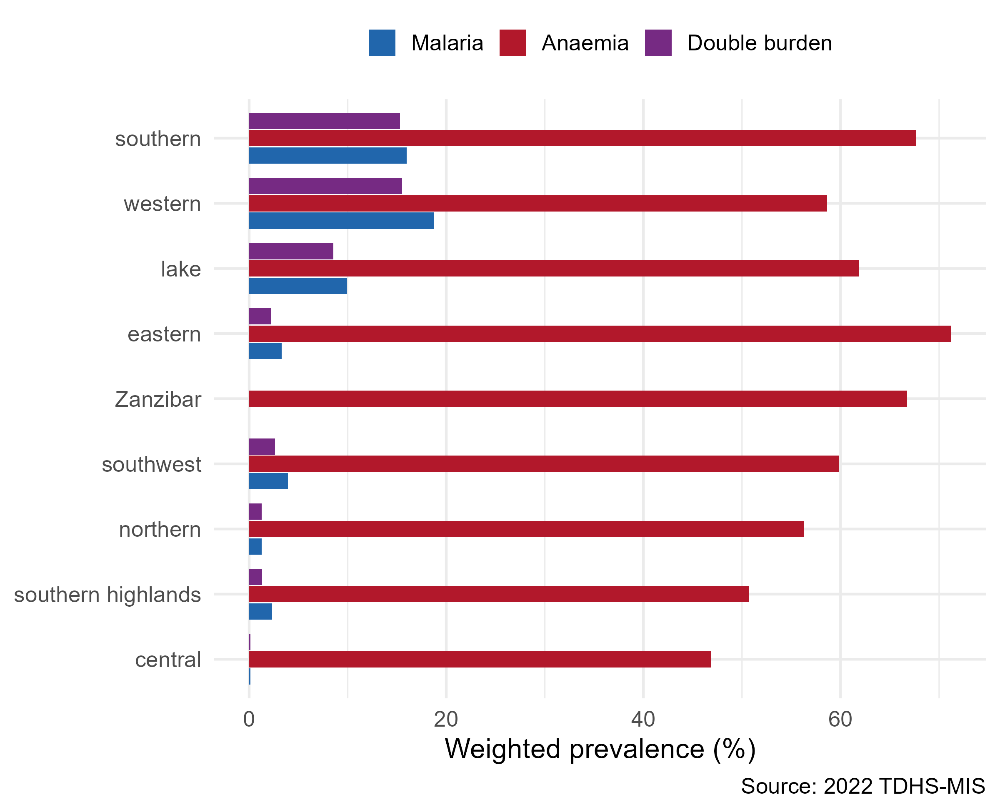
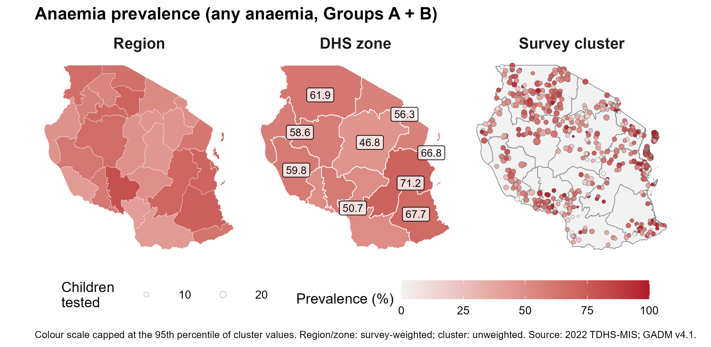
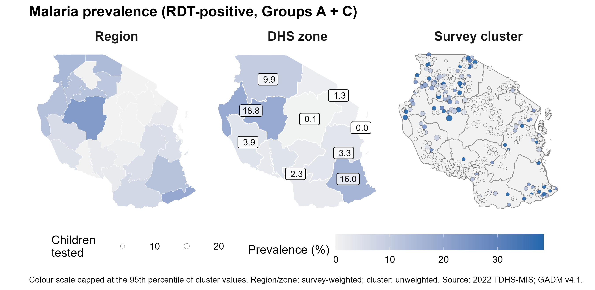
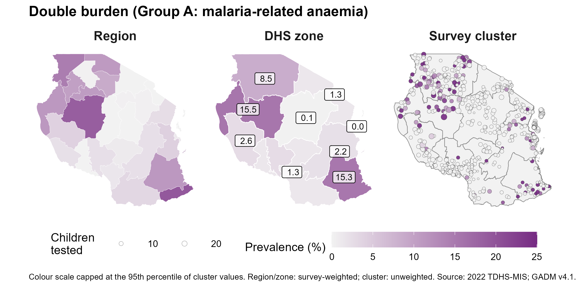
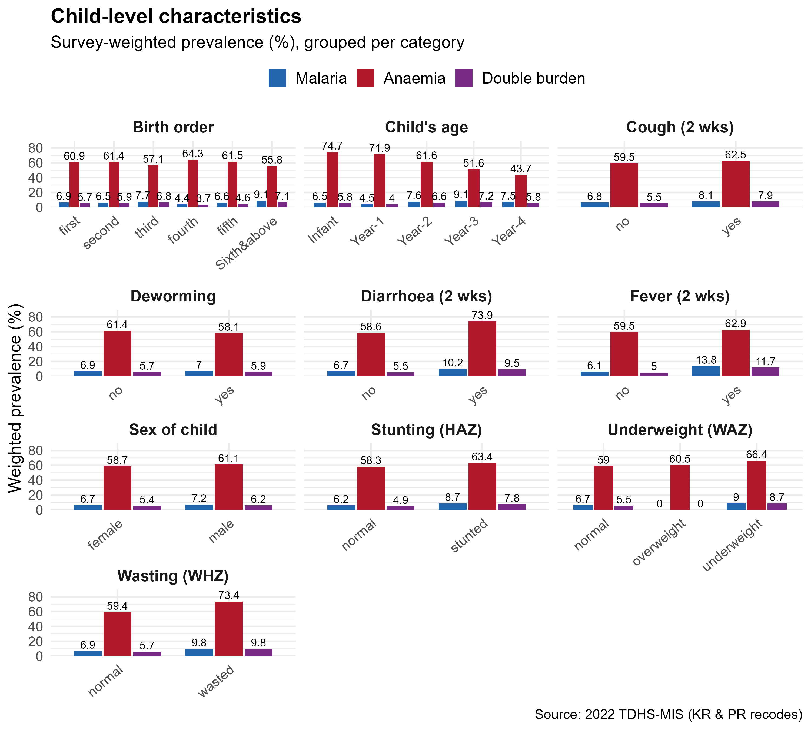
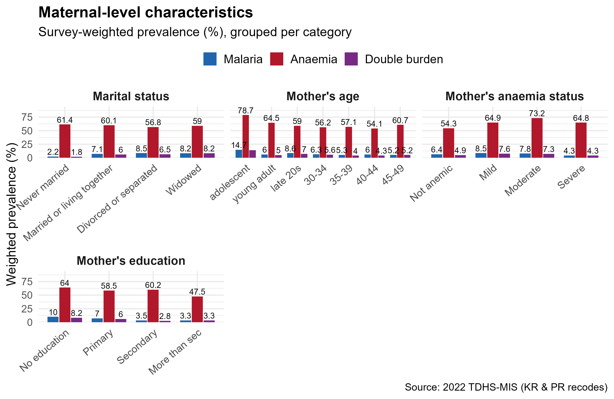
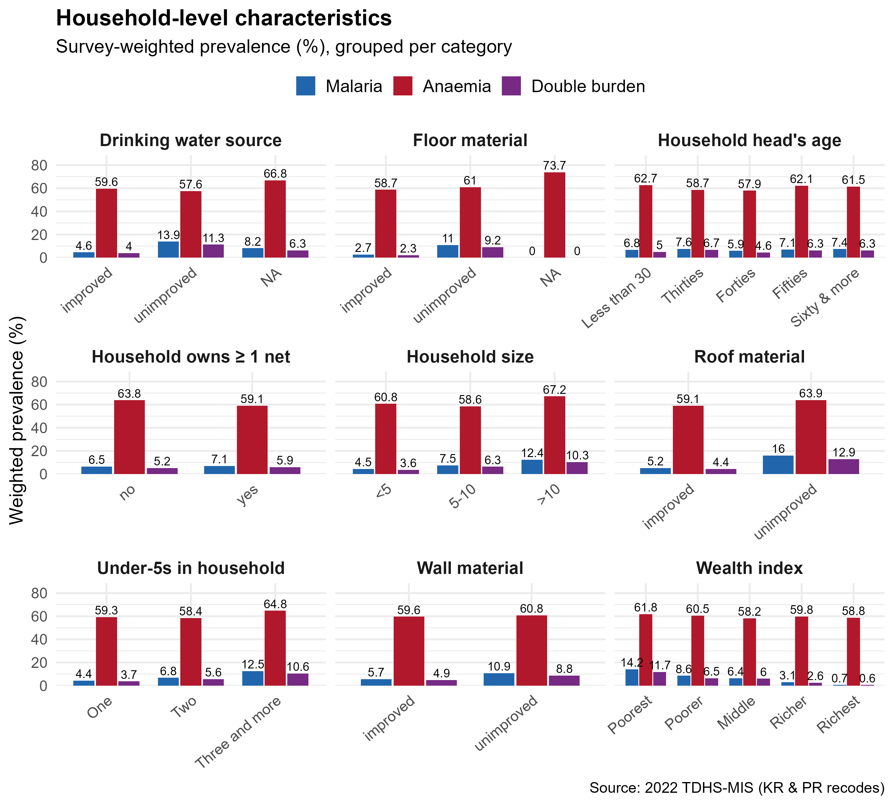
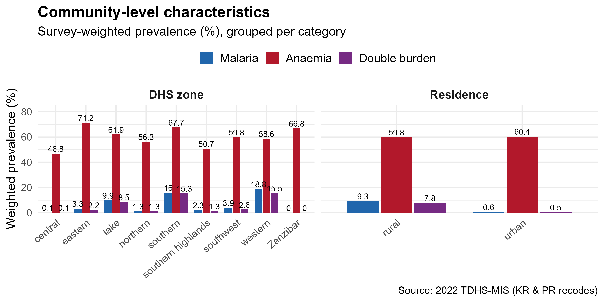

```{=latex}
\thispagestyle{empty}
\begin{center}
\vspace*{3.5cm}
{\LARGE\bfseries Spatial distribution and determinants of the co-occurrence of malaria and anaemia among under-five children in Tanzania\par}
\vspace{1.5cm}
{\large Independent project final report\par}
\vspace{2.5cm}
{\large Compiled and written by:\par}
\vspace{0.6cm}
{\large\bfseries Babalola Ayodele Samuel\par}
\vspace{0.2cm}
{\large \&\par}
\vspace{0.2cm}
{\large\bfseries Annabel Itaeli\par}
\vspace{1.5cm}
{\normalsize November 2026\par}
\end{center}
\clearpage
```

```{r setup}
#| include: false
library(knitr)
library(kableExtra)
options(knitr.kable.NA = "")

# Convert plain-text table cells to LaTeX-safe strings (pdflatex-friendly)
tex <- function(x) {
  x <- gsub("%", "\\\\%", x)
  x <- gsub("&", "\\\\&", x)
  x <- gsub("<", "$<$", x)
  x <- gsub(">", "$>$", x)
  x <- gsub("\u2265", "$\\\\geq$", x)
  x <- gsub("\u2212", "$-$", x)
  x <- gsub("\u03c7\u00b2", "$\\\\chi^2$", x)
  x
}

# Build a booktabs table from a pipe-separated text block (first row = header)
mk <- function(txt, font = 9) {
  d <- utils::read.delim(text = txt, sep = "|", quote = "", comment.char = "",
                         colClasses = "character", check.names = FALSE,
                         strip.white = TRUE, header = TRUE)
  hd <- tex(names(d))
  d[] <- lapply(d, tex)
  knitr::kable(d, format = "latex", booktabs = TRUE, linesep = "", escape = FALSE,
               col.names = hd, align = c("l", rep("c", ncol(d) - 1)), row.names = FALSE) |>
    kableExtra::kable_styling(latex_options = c("hold_position", "scale_down"), font_size = font) |>
    kableExtra::row_spec(0, bold = TRUE)
}
```

# Introduction
## Problem definition
Malaria and anaemia remain major causes of morbidity and mortality among children under five in sub-Saharan Africa, including Tanzania. Young children are particularly vulnerable to malaria because their immune systems are still developing. *Plasmodium falciparum* destroys parasitised and non-parasitised red blood cells and suppresses bone-marrow erythropoiesis, increasing the risk of anaemia [@adam2025; @mwaiswelo2021; @white2018]. Tanzania's National Malaria Control Programme (NMCP) has expanded insecticide-treated nets (ITNs), indoor residual spraying, seasonal chemoprevention and case management. Although national malaria prevalence has declined, substantial geographic variation remains, with prevalence in regions such as Tabora, Kagera and Mtwara several times the national average [@adam2025; @animut2025].

Anaemia is more common than malaria among children under five and has multiple causes, including iron and micronutrient deficiencies, poor complementary feeding, intestinal helminths, other infections and socioeconomic disadvantage [@elmardi2020; @saidi2025]. Much childhood anaemia in Tanzania may therefore occur without concurrent malaria infection; malaria control alone is unlikely to reduce the full burden.

Preliminary analysis of the 2022 Tanzania Demographic and Health Survey and Malaria Indicator Survey (TDHS-MIS) among children aged 6--59 months with complete rapid diagnostic test (RDT) and haemoglobin results (n = 4,147) found a survey-weighted malaria RDT prevalence of 7.0% (95% CI 5.7--8.6), anaemia prevalence of 59.9% (95% CI 57.7--62.1) and co-occurrence of 5.8% (95% CI 4.7--7.2) (254, 2,510 and 210 children, respectively). Thus, about 90% of anaemic children (weighted 90.3%) tested negative for malaria, indicating no detectable concurrent parasitaemia at the time of the survey.

This pattern presents two programmatic challenges. Malaria risk mapping used to guide NMCP vector-control and case-management decisions would overlook most anaemia, while anaemia programmes that ignore malaria-related anaemia may under-prioritise ITNs and prompt diagnosis in high-risk populations [@adam2025; @animut2025]. This project separates anaemia accompanied by a positive malaria RDT from anaemia without detectable malaria, identifies the determinants of each, and compares their profiles to inform integrated and pathway-specific interventions.

## Literature review
Seven peer-reviewed studies were reviewed to situate this project within evidence on malaria and anaemia among children under five in Tanzania and comparable sub-Saharan African settings.

**Malaria prevalence and determinants in Tanzania**. Using the 2022 TDHS-MIS, @adam2025 reported 8% national malaria RDT positivity among children aged 6--59 months, ranging from 23% in Tabora to below 1% in several central and Zanzibari regions. Older age, rural residence, lower wealth and not sleeping under an ITN were independent predictors. @animut2025 identified spatial clustering in the Western and Lake zones (Global Moran's I = 0.14) and associations with wealth, access to care, maternal education, child age, family size and roofing, highlighting the value of multilevel analysis for clustered DHS data.

**Malaria, anaemia and co-occurrence**. In Masasi and Nanyumbu districts, @mwaiswelo2021 reported malaria and anaemia prevalences of 15.9% and 53.9%, respectively; anaemia was consistently more common among malaria-positive children. Bednet non-use and poor housing were also associated with anaemia. In school-aged children in Ethiopia, @gena2025 found substantially higher odds of anaemia among malaria-infected children, although most anaemic children were not infected. Determinants differed between outcomes, supporting separate analyses of the two pathways.

**Broader determinants of childhood anaemia**. In Sudan, @elmardi2020 reported 49.4% anaemia prevalence and found that predictors varied by age: economic status was the only predictor under age two, whereas maternal anaemia, malaria and residence were associated with anaemia at ages 2--5. A six-year hospital-based study in Tanzania found that anaemia prevalence declined from 72% to 33% between 2015 and 2020, with malaria remaining a strong correlate alongside dietary practices that may inhibit iron absorption [@saidi2025].

**Regional evidence**. Across eight West African countries, @sacla2025 found that ITN use was protective in half of the countries and that prevalence varied from below 10% in Ghana to almost 40% in Benin. Their findings support geostatistical approaches and adjustment for age, wealth and net use.

Overall, the literature indicates that anaemia prevalence generally exceeds malaria prevalence; determinants overlap but may act through different mechanisms; and the reviewed studies did not explicitly partition anaemia by concurrent malaria status and compare the determinants within one national dataset. This project addresses that gap.

## Research objectives
1.  Estimate the spatial prevalence of malaria, anaemia and their combined double burden among children aged 6--59 months in Tanzania, and how these vary by region/zone and background characteristics.

2.  Identify individual-, household- and community-level factors associated with malaria-related anaemia (anaemia with a positive malaria RDT).

3.  Identify factors associated with non-malaria-related anaemia (anaemia with a negative malaria RDT).

4.  Formally test the extent to which the determinants in Objectives 2 and 3 overlap and draw out implications for integrated versus targeted malaria- and nutrition/anaemia-control programming in Tanzania (e.g., NMCP and anaemia/nutrition programmes).

# Methodology
## Study area
Tanzania comprises 26 mainland regions and the Zanzibar archipelago, grouped by the DHS Program into nine analytic zones: Central, Northern, Eastern, Southern, Southern Highlands, Southwest, Western, Lake and Zanzibar. The 2022 TDHS-MIS is a nationally representative, two-stage stratified cluster survey. Enumeration areas were selected with probability proportional to size within region and urban--rural strata, followed by systematic household sampling. Malaria RDTs and haemoglobin measurements were offered to consenting children aged 6--59 months.

## Data sources
Four TDHS-MIS recode files and one geospatial file were used:

-   Children's Recode (KR): one record per living child, providing age, sex, birth order and anthropometric variables.

-   Household Member Recode (PR): providing the malaria RDT result (hml35) and adjusted haemoglobin concentration (hc56) for every tested household member, merged to the KR file by cluster, household and child line number.

-   Household Recode (HR) and Individual/Women's Recode (IR): providing household-level variables (wealth index, housing materials, water source, net ownership) and maternal-level variables (education, age, anaemia status) respectively.

-   Geographic (GE) Recode: cluster-level GPS coordinates, used with Tanzania's GADM v4.1 administrative boundaries to produce the region- and zone-level maps and to assign each cluster to a DHS zone.

All analyses applied the DHS sampling weight (v005/1,000,000), primary sampling unit (v021) and stratification variable (v022) to account for the complex survey design.

## Approach {#sec-approach}
Anaemia was defined as haemoglobin \<11 g/dL among children aged 6--59 months; malaria was defined by a positive RDT. Children were classified into four mutually exclusive groups:

A, malaria-related anaemia (RDT-positive and anaemic); B, non-malaria-related anaemia (RDT-negative and anaemic); C, malaria without anaemia; and D, neither condition (reference). Because RDTs detect current or recent infection, Group B may include children with anaemia following a resolved malaria episode. The classification therefore distinguishes anaemia with and without detectable concurrent infection rather than establishing causality.

Candidate predictors were drawn from the literature and grouped by level: child (age, sex, birth order, stunting/wasting, recent fever, diarrhoea or cough, deworming and vitamin A/iron supplementation); maternal (education, age, marital status and anaemia); household (wealth, size, number of children under five, household-head characteristics, housing materials, water source and ITN ownership); and community (urban/rural residence and DHS zone).

**Variable selection.** Candidate predictors were screened against each outcome with Rao--Scott $\chi^2$ tests and unadjusted modified-Poisson prevalence ratios (threshold p \< 0.20) and then chosen for the multivariable models on the basis of literature support and parsimony, because Group A contained only 210 children and limited the number of parameters that could be estimated reliably. Predictor sets therefore differ slightly between models: household ITN ownership entered only Model 1 (it acts on malaria exposure), recent fever and deworming entered only Model 2, and Model 3 used the predictors common to both. Child sex was unrelated to either outcome (p \> 0.30) and was dropped; iron supplementation could not be estimated (the unadjusted model failed for lack of variation); vitamin A supplementation, health insurance and sex of the household head met the screening threshold but were not retained. Vitamin A and insurance were recorded only for children under 3 years (none of the 36--59-month-olds had values): adding them to the models reduced the complete-case sample from 1,643 to 754 children in Model 1 and from 3,542 to 2,090 in Model 2, and excluded all children aged 36--59 months. In Model 1 insurance also perfectly predicted the absence of malaria-related anaemia, giving an inestimable odds ratio. In this reduced sample the main associations kept their direction (e.g., wealth, unimproved water and household size \>10 in Model 1; age gradient, maternal anaemia and zone in Model 2), although several estimates lost precision, and insurance was protective for non-malaria-related anaemia (AOR 0.41, 95% CI 0.23--0.72); these variables are therefore not represented in the main models and residual confounding by health-service access cannot be excluded. Household ITN ownership, rather than individual net use, was screened.

Weighted prevalence, with 95% confidence intervals, was estimated overall and by region, zone and background characteristic using the survey-design estimator in the R survey/srvyr packages: each child was weighted by the DHS sampling weight (v005/1,000,000), clusters (v021) were the primary sampling units and v022 the strata, and the weighted prevalence is the weighted proportion of children with the outcome (confidence intervals by Taylor-series linearisation, on the logit scale for Tables 1--2). Unweighted counts are shown alongside. Two survey-weighted logistic models (quasibinomial svyglm) compared Group A with Group D (Model 1, malaria-related anaemia) and Group B with Group D (Model 2, non-malaria-related anaemia). Region was excluded from Model 1 because near-zero malaria positivity in some zones caused quasi-complete separation and unstable estimates; it was retained in Model 2, where a separation diagnostic (detectseparation) found no separation.

To compare pathways on a common basis, a survey-weighted multinomial model (Model 3; svyVGAM) was fitted to a common complete-case sample, using identical predictors and Group D as the reference; region was excluded from both equations. A predictor was descriptively classified as shared when its adjusted odds ratios (AORs) had the same direction in both models, pathway-specific when the direction was evident in only one, and divergent when directions opposed. Design-based Wald contrasts compared outcome-specific coefficients $\exp(\beta_A - \beta_B)$, with omnibus Wald F-tests and Holm correction assessing differences across pathways.

**Missing data and reference categories.** Of 4,166 children with valid RDT and haemoglobin results, 4,147 (99.5%) had complete data on the screening covariates and formed the analytic sample. The multivariable models used complete cases: children missing any model covariate were excluded, reducing the sample to 1,643 of 1,803 children in Model 1 (8.9% lost), 3,542 of 3,893 in Model 2 (9.0%) and 3,725 of 4,103 in Model 3 (9.2%). Missingness was not modelled and no sensitivity analysis (e.g., multiple imputation) was performed (@sec-discussion). Group C (malaria without anaemia; n = 44) was not modelled: it is too small for stable estimation and lies outside the research question, which concerns the two anaemia pathways; it is reported descriptively only. Reference categories were infants (6--11 months) for child age, rural residence, the poorest wealth quintile, maternal education 'more than secondary', mild maternal anaemia, an improved water source, households of fewer than five members, the Central zone, and 'no' for stunting, wasting, fever, deworming and ITN ownership. Age categories are reported in months: 12--23 (Year 1), 24--35 (Year 2), 36--47 (Year 3) and 48--59 months (Year 4).

**Spatial analysis and model structure.** Spatial analysis was primarily descriptive: Objective 1 concerns the level and geographic pattern of prevalence, so outcomes were mapped at region, zone and cluster level. Spatial dependence was summarised with global Moran's I, computed on the cluster-level prevalence of each outcome (621 clusters) with a row-standardised weights matrix based on the eight nearest clusters (great-circle distances) and a one-sided test against randomisation (R package spdep). Local hotspot statistics (e.g., Getis--Ord Gi\*) were not computed because cluster-level proportions rest on few children per cluster (about seven on average) and DHS randomly displaces cluster coordinates (up to 2 km in urban and 5 km in rural areas, and up to 10 km for 1% of rural clusters), which limits fine-scale inference. Region- and zone-level estimates are survey-weighted; cluster-level proportions are unweighted. The models are single-level: community-level factors (residence, zone) enter as covariates and clustering is handled through design-based standard errors (clusters as PSUs) rather than random effects. Geostatistical and multilevel extensions are discussed in @sec-discussion.

Variance inflation factors and separation diagnostics informed model specification. Analyses were conducted in R using the survey and svyVGAM packages. The study used de-identified, publicly available TDHS-MIS data obtained through an approved DHS Program request; no new participant data were collected.

# Results
## Descriptive prevalence
Among children aged 6--59 months with complete malaria RDT and haemoglobin data (n = 4,147), the survey-weighted prevalence of malaria (RDT-positive) was 7.0% (95% CI 5.7--8.6), of anaemia 59.9% (95% CI 57.7--62.1) and of the double burden 5.8% (95% CI 4.7--7.2) (@tbl-prevalence).

```{r}
#| label: tbl-prevalence
#| tbl-cap: 'Prevalence of malaria, anaemia and the double burden (n = 4,147): unweighted counts and survey-weighted prevalence (95% CI).'
mk("
Indicator|Positive/Yes (n)|Negative/No (n)|Unweighted prevalence (%)|Weighted prevalence, % (95% CI)
Malaria (RDT positive)|254|3,893|6.1%|7.0 (5.7--8.6)
Anaemia (Hb < 11 g/dL)|2,510|1,637|60.5%|59.9 (57.7--62.1)
Double burden (malaria AND anaemia)|210|3,937|5.1%|5.8 (4.7--7.2)
", font = 9)
```

Applying the four-group case definition (@sec-approach), the sample decomposes as shown in @tbl-groups.

```{r}
#| label: tbl-groups
#| tbl-cap: 'Four-group malaria--anaemia classification (n = 4,147): unweighted n and survey-weighted percentage (95% CI).'
mk("
Group|n|Unweighted %|Weighted % (95% CI)
A: Malaria-related anaemia (RDT+ and anaemic)|210|5.1%|5.8 (4.7--7.2)
B: Non-malaria-related anaemia (RDT\u2212 and anaemic)|2,300|55.5%|54.1 (51.8--56.4)
C: Malaria without anaemia (RDT+ and not anaemic)|44|1.1%|1.1 (0.8--1.7)
D: Neither malaria nor anaemia (reference)|1,593|38.4%|38.9 (36.7--41.2)
", font = 9)
```

Among anaemic children (n = 2,510), 9.7% (95% CI 7.8--12.0) were malaria-positive and 90.3% (Group B) were malaria-negative (weighted). Most anaemia was therefore not accompanied by detectable concurrent malaria. Conversely, 83.5% (95% CI 77.0--88.5) of malaria-positive children were anaemic, compared with 58.2% (95% CI 55.8--60.4) of malaria-negative children, indicating a crude association consistent with @mwaiswelo2021 and @gena2025.

## Spatial distribution
Weighted prevalence of malaria, anaemia and their co-occurrence was mapped by region, DHS zone and survey cluster (@fig-zone, @fig-anaemia, @fig-malaria and @fig-double; cluster-level proportions are unweighted) to characterise subnational variation, following @adam2025 and @animut2025. Anaemia prevalence was high across zones (47--71%), peaking in the Eastern zone (71.2%) and lowest in the Central zone (46.8%). Malaria and double-burden prevalence were concentrated in the Western and Southern zones and were negligible in the Central zone (0.1%). Cluster-level maps also revealed substantial local variation within zones, consistent with the fine-scale clustering reported by @animut2025. Global Moran's I showed weak but statistically significant positive spatial autocorrelation in cluster-level prevalence of malaria (I = 0.113, p \< 0.001), anaemia (I = 0.158, p \< 0.001) and the double burden (I = 0.106, p \< 0.001): nearby clusters tended to have similar prevalence, although the modest values indicate considerable local variation. The malaria estimate is close to the I = 0.14 reported by @animut2025.

```{r}
#| label: fig-zone
#| fig-cap: 'Weighted malaria, anaemia and double-burden prevalence by DHS zone.'
#| fig-align: center
#| out-width: '71%'

```

```{r}
#| label: fig-anaemia
#| fig-cap: 'Anaemia prevalence (any anaemia, Groups A + B) by region, DHS zone and survey cluster. Colour scales are capped at the 95th percentile of cluster values; region and zone values are survey-weighted, cluster values unweighted.'
#| fig-align: center
#| out-width: '80%'

```

```{r}
#| label: fig-malaria
#| fig-cap: 'Malaria prevalence (RDT-positive, Groups A + C) by region, DHS zone and survey cluster. Colour scales are capped at the 95th percentile of cluster values; region and zone values are survey-weighted, cluster values unweighted.'
#| fig-align: center
#| out-width: '80%'

```

```{r}
#| label: fig-double
#| fig-cap: 'Double-burden prevalence (Group A, malaria-related anaemia) by region, DHS zone and survey cluster. Colour scales are capped at the 95th percentile of cluster values; region and zone values are survey-weighted, cluster values unweighted.'
#| fig-align: center
#| out-width: '80%'

```

## Distribution by background characteristics
Malaria, anaemia and double-burden prevalence were further examined by child-, maternal-, household- and community-level characteristics (@fig-child, @fig-maternal, @fig-household and @fig-community; survey-weighted). Anaemia was most prevalent among infants (74.7%) and declined steadily with age to 43.7% at 4 years, whereas malaria and double-burden prevalence did not follow this gradient and were highest at age 3 (9.1% and 7.2%). Fever, diarrhoea, stunting and wasting were associated with higher prevalence of malaria (e.g. 13.8% with fever versus 6.1% without) and, for diarrhoea and wasting, of anaemia (73.9% and 73.4%) (@fig-child). Anaemia and malaria were highest among children of adolescent mothers (78.7% and 14.7%), and all three outcomes were lower with higher maternal education (malaria 10.0% with no education versus 3.3% with more than secondary; @fig-maternal). Malaria and double-burden prevalence rose steeply with poverty (14.2% and 11.7% among the poorest versus 0.7% and 0.6% among the richest) and were higher with unimproved roofing (16.0% versus 5.2% malaria), unimproved drinking water (13.9% versus 4.6%) and larger households (12.4% for \>10 members versus 4.5% for \<5; @fig-household). At community level, malaria and double burden were concentrated in rural clusters (9.3% and 7.8% versus 0.6% and 0.5% urban), and in the Western (18.8% and 15.5%) and Southern (16.0% and 15.3%) zones, while anaemia varied little by residence (59.8% versus 60.4%) but was highest in the Eastern zone (71.2%) and lowest in the Central zone (46.8%; @fig-community). Overall, malaria and double burden tracked socioeconomic and geographic disadvantage, whereas anaemia varied most clearly with child age.

```{r}
#| label: fig-child
#| fig-cap: 'Child-level characteristics.'
#| fig-align: center
#| out-width: '79%'

```

```{r}
#| label: fig-maternal
#| fig-cap: 'Maternal-level characteristics.'
#| fig-align: center
#| out-width: '100%'

```

```{r}
#| label: fig-household
#| fig-cap: 'Household-level characteristics.'
#| fig-align: center
#| out-width: '77%'

```

```{r}
#| label: fig-community
#| fig-cap: 'Community-level characteristics.'
#| fig-align: center
#| out-width: '75%'

```

## Determinants of malaria-related and non-malaria-related anaemia
After adjustment for age, residence, wealth, maternal education and anaemia, household ITN ownership, water source, household size and nutritional status, children aged 12--23 and 48--59 months had lower odds of malaria-related anaemia than infants (AOR 0.42, 95% CI 0.20--0.87; and 0.39, 95% CI 0.20--0.77; @tbl-model1). Urban residence was protective (AOR 0.16, 95% CI 0.05--0.55), as were the poorer (AOR 0.59) and richest (AOR 0.14) wealth categories relative to the poorest (both p \< 0.05). An unimproved water source (AOR 1.56, 95% CI 1.00--2.41) and a household size above 10 (AOR 2.35, 95% CI 1.05--5.26) were associated with higher odds. Maternal education categories (reference: more than secondary) had very wide intervals (AORs 0.13--0.16; all p \> 0.10) because the reference group was sparse, so no education effect can be inferred. Region was excluded because of separation: when it was included, zone odds ratios exceeded $10^6$ and Zanzibar had no cases (@sec-approach); regional patterns are shown in @fig-zone, @fig-malaria and @fig-double.

```{r}
#| label: tbl-model1
#| tbl-cap: 'Determinants of malaria-related anaemia (Model 1: Group A vs. Group D, n = 1,643). Reference categories as in @sec-approach (age: infants 6--11 months; education: more than secondary). Education estimates are imprecise because the reference category is sparse.'
mk("
Predictor / category|AOR (95% CI)|p-value
Age: 12--23 months|0.415 (0.198--0.873)|0.0206
Age: 24--35 months|0.792 (0.401--1.564)|0.501
Age: 36--47 months|0.595 (0.336--1.055)|0.0753
Age: 48--59 months|0.390 (0.199--0.766)|0.00633
Urban residence|0.157 (0.045--0.546)|0.00364
Wealth: Poorer|0.591 (0.369--0.949)|0.0296
Wealth: Middle|0.551 (0.301--1.009)|0.0533
Wealth: Richer|0.387 (0.115--1.311)|0.127
Wealth: Richest|0.140 (0.034--0.576)|0.00652
Education: No education|0.15 (0.01--1.99)|0.149
Education: Primary|0.13 (0.01--1.61)|0.111
Education: Secondary|0.16 (0.01--2.08)|0.159
Maternal anaemia: Moderate|1.778 (0.822--3.846)|0.144
Maternal anaemia: Not anaemic|0.647 (0.407--1.028)|0.0655
Maternal anaemia: Severe|0.659 (0.096--4.536)|0.671
Household owns \u22651 ITN|1.218 (0.673--2.206)|0.514
Water source: Unimproved|1.556 (1.004--2.412)|0.0481
Household size: 5--10|1.476 (0.933--2.334)|0.0959
Household size: >10|2.347 (1.047--5.257)|0.0383
Stunted|1.469 (0.964--2.238)|0.0736
Wasted|2.034 (0.808--5.122)|0.131
", font = 8.5)
```

In Model 2 (non-malaria-related anaemia; n = 3,542; @tbl-model2), odds fell steadily with age relative to infants (24--35 months: AOR 0.47, 95% CI 0.33--0.67; 36--47 months: 0.30, 0.21--0.44; 48--59 months: 0.24, 0.17--0.34; all p \< 0.001). Compared with the Central zone, odds were higher in the Eastern (AOR 2.43, 95% CI 1.70--3.46), Zanzibar (1.96, 1.37--2.80), Southwest (1.51, 1.04--2.17) and Lake (1.38, 1.00--1.90) zones (all p \< 0.05). Relative to mothers with mild anaemia, moderate maternal anaemia was associated with higher odds in the child (AOR 1.56, 95% CI 1.12--2.17, p = 0.009) and a non-anaemic mother with lower odds (AOR 0.73, 95% CI 0.58--0.91, p = 0.006). Wealth, education, residence, water source, household size, stunting, wasting, fever and deworming were not significant after adjustment.

```{r}
#| label: tbl-model2
#| tbl-cap: 'Determinants of non-malaria-related anaemia (Model 2: Group B vs. Group D, n = 3,542). AOR (95% CI) from the survey-weighted logistic model; reference categories as in @sec-approach (age: infants 6--11 months).'
mk("
Predictor / category|AOR (95% CI)|p-value
Age: 12--23 months|0.82 (0.57--1.17)|0.272
Age: 24--35 months|0.47 (0.33--0.67)|<0.001
Age: 36--47 months|0.30 (0.21--0.44)|<0.001
Age: 48--59 months|0.24 (0.17--0.34)|<0.001
Urban residence|1.12 (0.85--1.48)|0.425
Region: Eastern|2.43 (1.70--3.46)|<0.001
Region: Lake|1.38 (1.00--1.90)|0.0475
Region: Northern|1.00 (0.67--1.51)|0.990
Region: Southern|1.70 (1.00--2.90)|0.0507
Region: Southern Highlands|1.02 (0.72--1.45)|0.895
Region: Southwest|1.51 (1.04--2.17)|0.0284
Region: Western|1.05 (0.71--1.54)|0.817
Region: Zanzibar|1.96 (1.37--2.80)|<0.001
Wealth: Poorer|1.15 (0.87--1.51)|0.317
Wealth: Middle|0.92 (0.68--1.24)|0.579
Wealth: Richer|0.95 (0.62--1.44)|0.796
Wealth: Richest|0.92 (0.60--1.41)|0.714
Education: No education|1.76 (0.82--3.77)|0.144
Education: Primary|1.34 (0.64--2.81)|0.445
Education: Secondary|1.48 (0.70--3.12)|0.302
Maternal anaemia: Moderate|1.56 (1.12--2.17)|0.00917
Maternal anaemia: Not anaemic|0.73 (0.58--0.91)|0.00610
Maternal anaemia: Severe|0.90 (0.44--1.85)|0.772
Water source: Unimproved|0.80 (0.64--1.00)|0.0533
Household size: 5--10|0.95 (0.77--1.16)|0.598
Household size: >10|1.31 (0.93--1.85)|0.118
Stunted|1.21 (0.97--1.51)|0.0836
Wasted|1.11 (0.65--1.88)|0.704
Fever|0.90 (0.65--1.24)|0.506
Deworming|0.96 (0.80--1.14)|0.624
", font = 8)
```

A harmonised multinomial model (Model 3; n = 3,725), with identical predictors and Group D as the shared reference, formally compared the pathways (@tbl-ratio and @tbl-omnibus). After Holm correction, associations differed significantly by pathway for child age (Wald F = 6.79, df = 4, 557, p \< 0.001), residence (F = 12.29, df = 1, 557, p = 0.001) and water source (F = 7.09, df = 1, 557, p = 0.016). Urban residence was more strongly protective against malaria-related anaemia (ratio of AORs 0.13, 95% CI 0.04--0.40), as was the richest-wealth category (0.17, 95% CI 0.05--0.58); unimproved water was associated with a greater increase in malaria-related anaemia (1.82, 95% CI 1.17--2.82). Maternal anaemia did not differ by pathway (omnibus F = 0.06, df = 3, 557, p = 0.980), supporting its classification as a shared determinant.

```{r}
#| label: tbl-ratio
#| tbl-cap: 'Harmonised model (Model 3): ratio of adjusted odds ratios ($\exp(\beta_A - \beta_B)$) comparing the two anaemia pathways directly (n = 3,725). Reference categories as in @sec-approach; the very wide education intervals reflect sparse data in some categories.'
mk("
Predictor / category|Ratio of AORs|95% CI|p-value
Age: 12--23 months|0.612|0.308--1.216|0.161
Age: 24--35 months|1.516|0.821--2.800|0.184
Age: 36--47 months|2.033|1.218--3.392|0.00672
Age: 48--59 months|1.722|0.944--3.143|0.0764
Urban residence|0.127|0.040--0.403|0.000491
Wealth: Poorer|0.513|0.324--0.812|0.00447
Wealth: Middle|0.655|0.358--1.200|0.171
Wealth: Richer|0.427|0.127--1.439|0.169
Wealth: Richest|0.173|0.052--0.576|0.00434
Education: No education|0.300|0.010--9.278|0.491
Education: Primary|0.383|0.013--11.641|0.581
Education: Secondary|0.374|0.011--12.169|0.579
Maternal anaemia: Moderate|1.118|0.544--2.298|0.761
Maternal anaemia: Not anaemic|0.999|0.627--1.590|0.995
Maternal anaemia: Severe|0.882|0.196--3.972|0.869
Water source: Unimproved|1.817|1.169--2.822|0.00798
Household size: 5--10|1.370|0.885--2.121|0.158
Household size: >10|1.597|0.725--3.515|0.245
Stunted|1.211|0.839--1.747|0.306
Wasted|1.481|0.662--3.312|0.338
", font = 8.5)
```

```{r}
#| label: tbl-omnibus
#| tbl-cap: 'Omnibus Wald tests of whether a predictor''s association with anaemia differs between the two pathways (Holm-adjusted for multiple comparisons).'
mk("
Predictor|Wald \u03c7\u00b2|Approx. F|df|Raw p|Holm-adj. p
Child age (4 restrictions)|27.171|6.793|4, 557|0.0000242|0.0000968
Residence (1 restriction)|12.293|12.293|1, 557|0.000491|0.001474
Water source (1 restriction)|7.088|7.088|1, 557|0.007983|0.015965
Maternal anaemia (3 restrictions)|0.184|0.061|3, 557|0.9800|0.9800
", font = 8.5)
```

# Discussion and Conclusion {#sec-discussion}
The harmonised analysis indicates that malaria-related and non-malaria-related anaemia are associated but statistically distinguishable. Residence, household wealth and water source differed significantly in their associations across pathways, plausibly reflecting differences in malaria exposure and access to protective infrastructure. Maternal anaemia was a shared determinant, consistent with a common nutritional or intergenerational pathway. Child age was the clearest correlate of non-malaria-related anaemia, with odds declining from infancy.

These patterns are broadly consistent with earlier work. The steep fall in non-malaria-related anaemia after infancy, and the finding that predictors vary by pathway and age, echo @elmardi2020, who reported that economic status predicted anaemia only under two years whereas maternal anaemia and residence mattered at 2--5 years. Higher malaria-related anaemia in rural, poorer and larger households agrees with the socioeconomic and housing gradients reported for malaria by @adam2025 and @animut2025 and for malaria-associated anaemia by @mwaiswelo2021, who also linked poor housing and bed-net non-use to anaemia. That most anaemic children were RDT-negative parallels @gena2025, where most anaemic children were not malaria-infected and anaemia-specific determinants differed from malaria-specific ones, and the shared effect of maternal anaemia is in line with @elmardi2020, suggesting common nutritional, genetic or household-level causes. One difference concerns age: @adam2025 found malaria infection more likely in older children, whereas malaria-related anaemia here was less likely beyond infancy, suggesting that age acts mainly through susceptibility to anaemia in young, less immune children rather than through parasite exposure.

Why an unimproved water source differed by pathway cannot be established from these data. Unimproved sources such as open ponds, streams and shallow wells are often close to vector breeding sites and to areas with poorer access to health services, so they may mark higher mosquito exposure and delayed treatment, both of which favour malaria-related anaemia; for non-malaria anaemia, any link through diarrhoeal disease or helminths may be diluted, as unimproved water was not significantly associated with it (AOR 0.80). Residence and wealth likely capture exposure to transmission and access to nets and prompt treatment, whereas higher non-malaria anaemia in the Eastern and Zanzibar zones, where malaria is low, points to other drivers such as diet, helminths or inherited haemoglobin disorders that the survey did not measure [@saidi2025; @gena2025].

A malaria risk map would identify the Western and Southern zones for vector control but miss much of the larger, more geographically widespread non-malaria anaemia burden. The NMCP should continue to target ITNs and case management to high-malaria zones, while nutrition and anaemia programmes should prioritise young children and maternal anaemia screening and treatment nationally. Integrated delivery (for example, linking ITNs with iron supplementation and maternal screening) may improve efficiency where service platforms overlap.

Several limitations apply. First, the design is cross-sectional, so associations are not causal and their temporal order is unknown; RDTs detect current or recent infection (the HRP2 antigen can persist after clearance, whereas low-density infections may be missed), so some Group B children may have anaemia following a resolved malaria episode, which would make the pathways look more alike. Second, region was excluded from Models 1 and 3 because of separation, although geography is a strong confounder for malaria; residual geographic confounding is possible, and penalised (Firth) regression or merging low-prevalence zones was not attempted. Third, the models used complete cases (about 9% of children lost per model) without imputation. Fourth, Group A is small (n = 210), producing wide intervals and unstable estimates in sparse categories such as maternal education. Fifth, the survey has no data on haemoglobinopathies, micronutrient status (iron, folate, vitamin B12) or helminth infection, major causes of non-malaria anaemia. Finally, the spatial analysis is limited to descriptive maps and global Moran's I: cluster-level estimates rest on few children and displaced GPS coordinates, no local hotspot analysis was done, and the models are single-level.

Future work could (i) fit a Bayesian geostatistical multinomial model (e.g., INLA/SPDE) to cluster-level counts and covariates to map the three outcomes continuously, with uncertainty and fine-scale heterogeneity; (ii) use multilevel models with cluster and region random effects, which would also allow region to be retained; (iii) add local hotspot analysis (Getis--Ord Gi\*, local Moran's I); (iv) link the survey to Malaria Atlas Project malaria covariates (e.g., parasite rate, ITN coverage) and to nutrition and environmental surfaces; and (v) add multiple imputation and Firth or merged-zone sensitivity analyses.

Malaria and anaemia among Tanzanian children under five should be treated as overlapping but distinct public-health problems. Separating anaemia by concurrent malaria status and formally testing determinant differences provides a more actionable evidence base than analysing either condition alone. The findings support geographically targeted malaria control alongside nationally delivered maternal and child nutrition interventions.

# Workload Distribution {.unnumbered}
-   Annabel Itaeli: data acquisition, extraction and variable construction from the KR/PR/HR/IR recodes; drafting and final review of the report.

-   Babalola Ayodele: spatial/GIS analysis and map production, data analysis and literature review; drafting and final review of the report.

-   Both team members reviewed and approved the final analytical decisions, including the exclusion of region from Model 1 and the harmonised-model comparison approach.

# AI Usage {.unnumbered}
AI (Claude (Anthropic)) assistance was used in a supporting, editorial and debugging capacity rather than to generate original findings. AI was used in reviewing and debugging the R data-cleaning and analysis code as well as proofreading for grammar. All data extraction, model specification choices, and interpretation of substantive findings were made and verified by the project team.

\newpage

# References {.unnumbered}

::: {#refs}
:::

